---
---
import 'katex/dist/katex.min.css';
import '../global.css'

## 1. Inteligencia Artificial aplicada a la genómica

La inteligencia artificial (IA) comprende métodos computacionales capaces de identificar patrones, aprender relaciones y realizar predicciones a partir de grandes volúmenes de datos.

En genómica, la IA permite analizar secuencias de ADN y ARN, identificar características biológicas y desarrollar modelos predictivos que complementan las herramientas tradicionales de bioinformática.

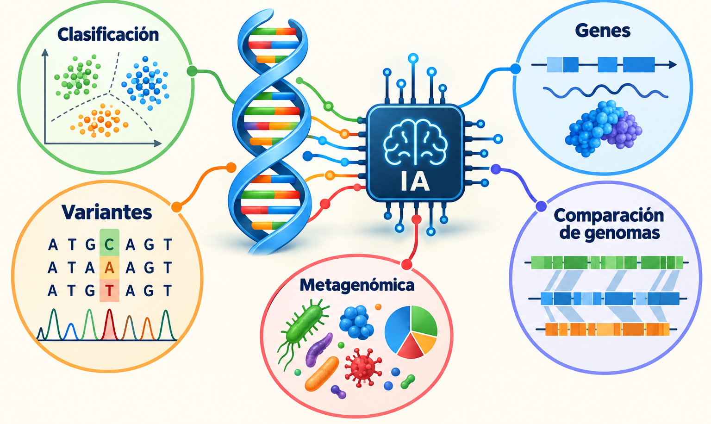

### Principales aplicaciones

- Clasificación de secuencias: identificación de grupos taxonómicos o regiones genómicas.
- Predicción de genes: reconocimiento de regiones codificantes y regulatorias.
- Análisis de variantes: predicción de posibles efectos funcionales de mutaciones.
- Metagenómica: clasificación de secuencias provenientes de comunidades microbianas.
- Genómica comparativa: identificación de patrones y diferencias entre genomas.

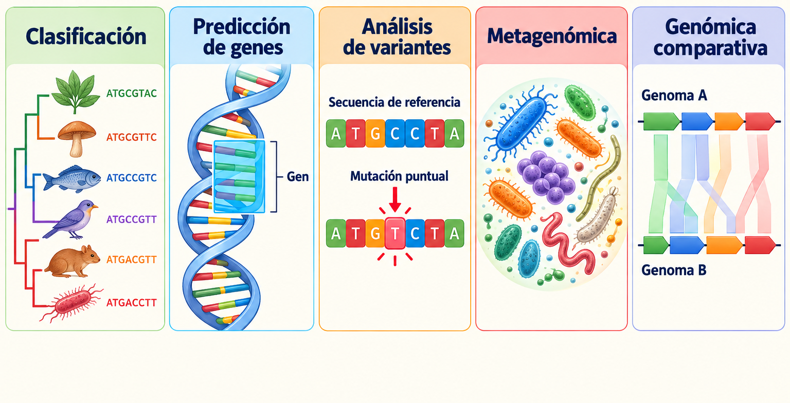

### Enfoques de aprendizaje

| Tipo de aprendizaje          | Característica                    | Aplicación                 |
| ---------------------------- | --------------------------------- | -------------------------- |
| Supervisado                  | Utiliza secuencias etiquetadas    | Clasificación taxonómica   |
| No supervisado               | Identifica patrones sin etiquetas | Agrupamiento genómico      |
| Autosupervisado              | Aprende de las propias secuencias | Modelos de lenguaje de ADN |
| Transferencia de aprendizaje | Reutiliza modelos preentrenados   | Predicción funcional       |

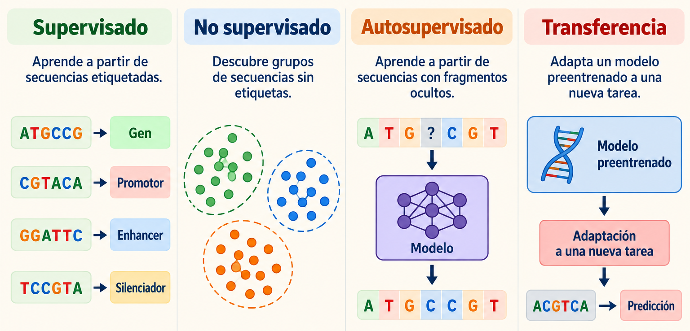

## 2. Representación computacional de secuencias genómicas

Los algoritmos de IA requieren transformar las secuencias biológicas en representaciones numéricas.

Una secuencia de ADN puede expresarse mediante el alfabeto:

$$
 \Sigma=\{A,C,G,T\} 
$$

Existen diferentes estrategias para representar esta información.

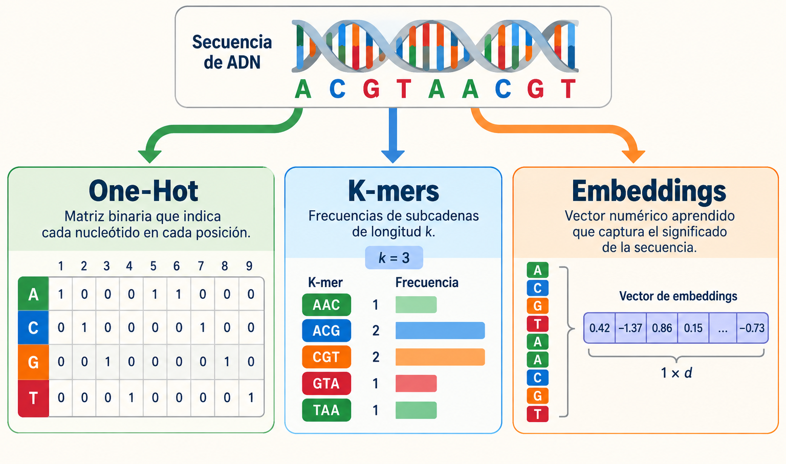

## 3. Aprendizaje automático para clasificación genómica

El aprendizaje automático (Machine Learning) permite construir modelos que identifican patrones en secuencias y predicen categorías biológicas.

En aprendizaje supervisado se dispone de un conjunto de datos:

$$
 D=\{(x_i,y_i)\}_{i=1}^{n} 
$$

Donde $x_i$ representa las características de una secuencia y $y_i$ su clasificación conocida.

El algoritmo aprende una relación entre las características y las etiquetas para realizar predicciones sobre nuevas secuencias.
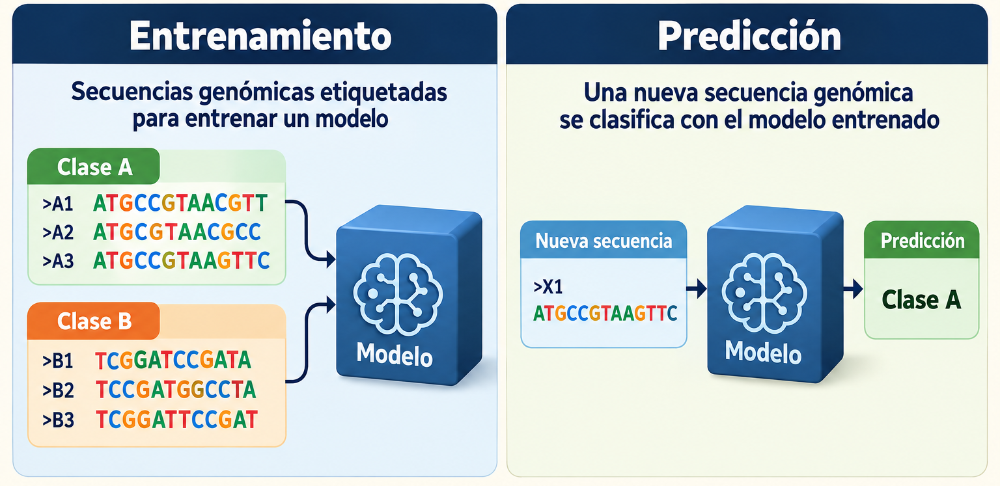

### Algoritmos principales

| Algoritmo     | Funcionamiento                                 | Aplicación                       |
| ------------- | ---------------------------------------------- | -------------------------------- |
| Random Forest | Combina múltiples árboles de decisión          | Clasificación de secuencias      |
| SVM           | Construye fronteras de separación entre clases | Reconocimiento de patrones       |
| K-means       | Agrupa datos por similitud                     | Exploración de secuencias        |
| PCA           | Reduce la dimensionalidad                      | Visualización de características |

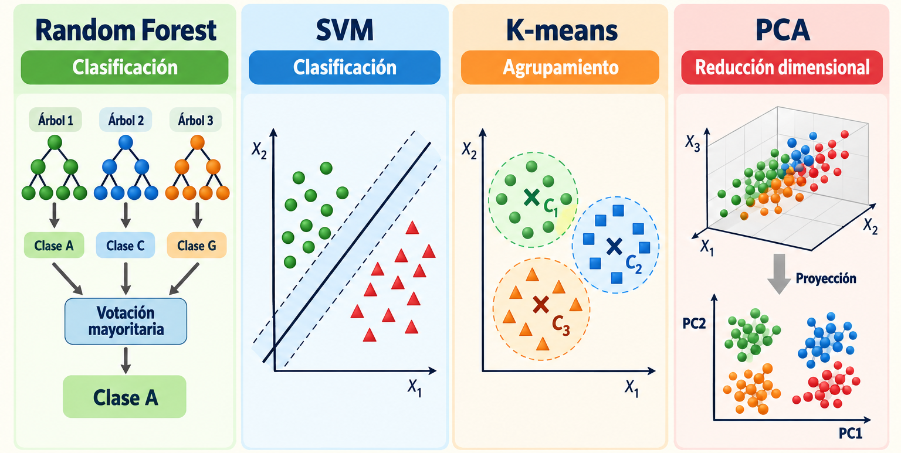

## 4. Aprendizaje profundo aplicado al ADN

El aprendizaje profundo (Deep Learning) utiliza redes neuronales con múltiples capas para aprender representaciones complejas directamente a partir de los datos.

A diferencia de los enfoques tradicionales, puede reducir la necesidad de diseñar manualmente todas las características de entrada.

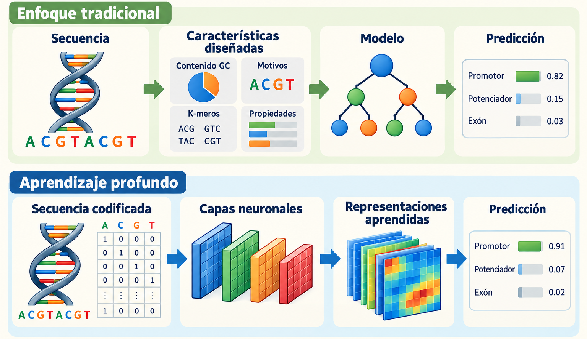

## 5. Modelos de lenguaje genómico

Los modelos de lenguaje genómico utilizan técnicas de procesamiento de secuencias para aprender regularidades estadísticas del ADN.

Durante el preentrenamiento pueden aprender a reconstruir fragmentos ocultos o realizar otras tareas autosupervisadas.

Posteriormente, sus representaciones pueden adaptarse a problemas específicos.

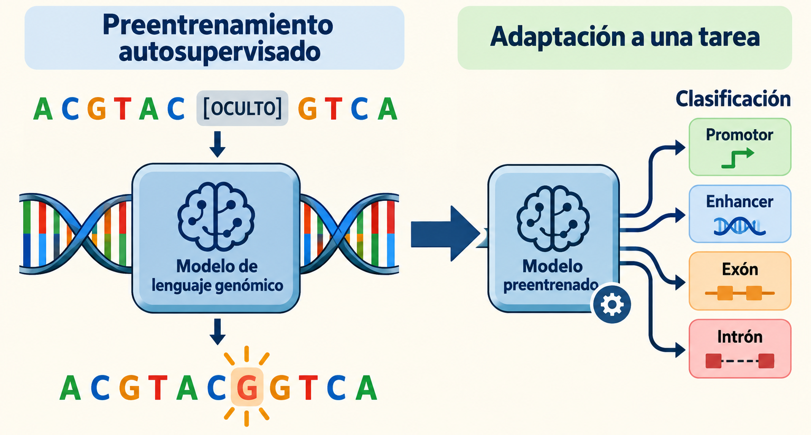

### DNABERT

DNABERT utiliza una arquitectura basada en BERT adaptada al ADN.

Entre sus aplicaciones se encuentran la clasificación de secuencias y la predicción de características funcionales.

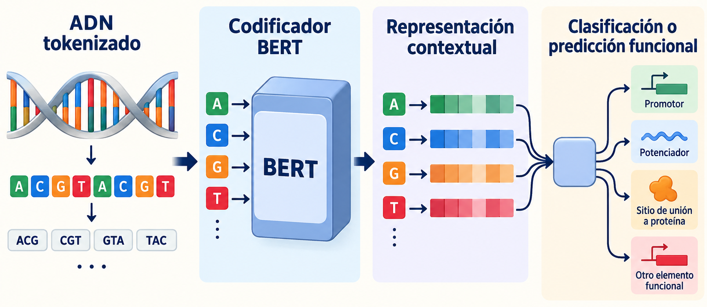

### Comparación de enfoques

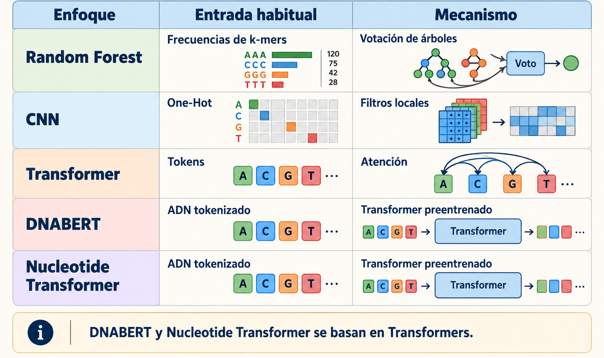

## 6. Entrenamiento y evaluación de modelos

El desarrollo de modelos de IA requiere dividir los datos en conjuntos independientes.

- Entrenamiento: permite ajustar los parámetros del modelo.
- Validación: permite seleccionar configuraciones y controlar el sobreajuste.
- Prueba: estima el desempeño con datos no utilizados durante el desarrollo.

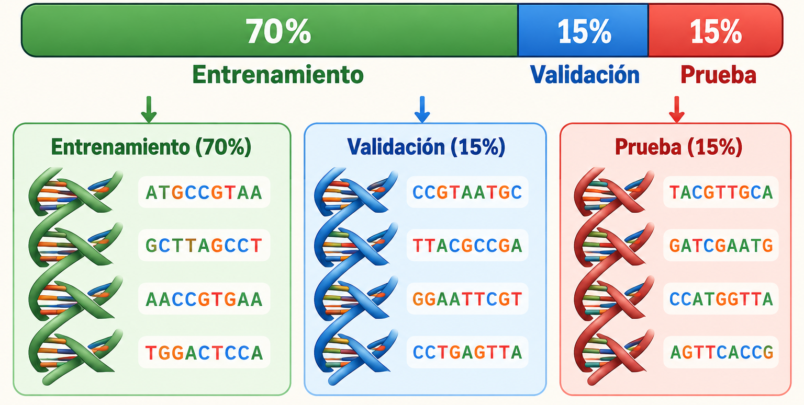

En genómica, es especialmente importante evitar que fragmentos altamente similares del mismo genoma aparezcan en diferentes conjuntos.

### Métricas principales

| Métrica             | Interpretación                              |
| ------------------- | ------------------------------------------- |
| Accuracy            | Proporción total de predicciones correctas  |
| Precision           | Confiabilidad de las predicciones positivas |
| Recall              | Capacidad de identificar casos positivos    |
| F1-score            | Equilibrio entre precisión y sensibilidad   |
| Matriz de confusión | Aciertos y errores por clase                |

El F1-score se calcula mediante:

$$
 F1=2\frac{Precision\cdot Recall}{Precision+Recall} 
$$

Una exactitud elevada no garantiza validez biológica. El modelo debe evaluarse con datos independientes y representativos del problema.

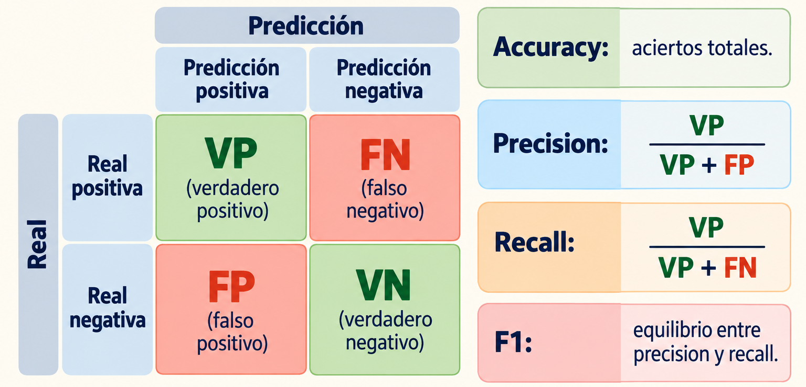

## 7. Flujo de trabajo de IA en genómica

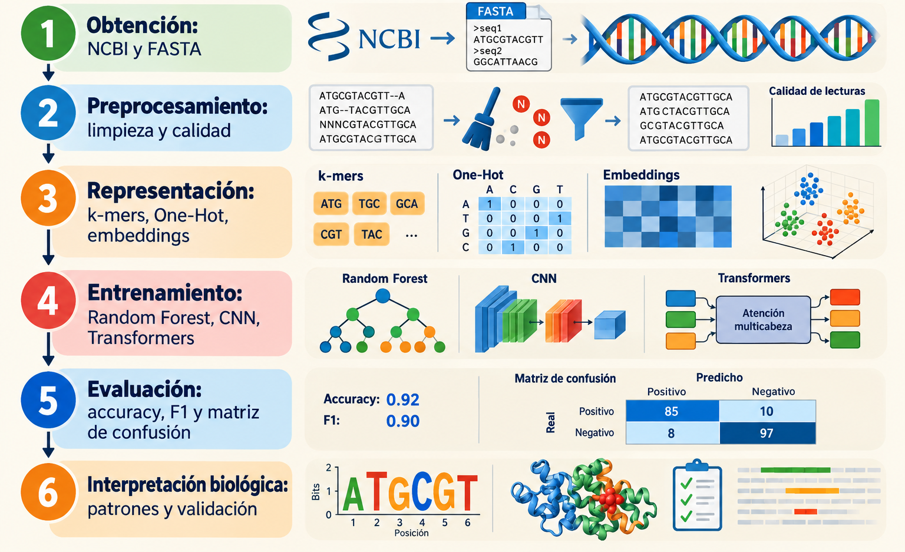

## 8. Limitaciones y perspectivas de la IA genómica

Aunque la IA permite analizar grandes cantidades de información, su aplicación presenta desafíos importantes.

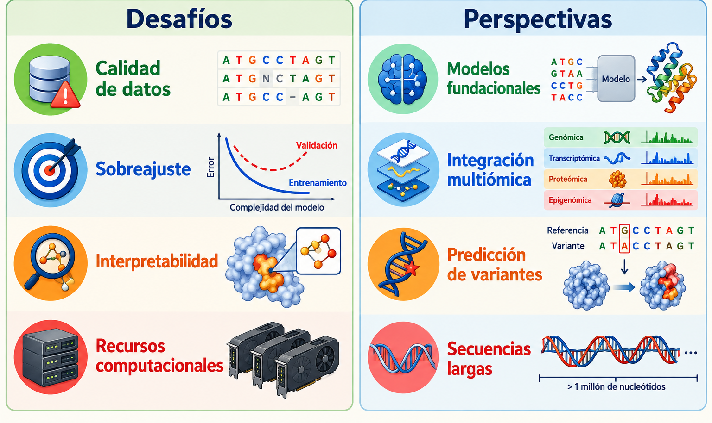

## 9. Conclusión

La aplicación de inteligencia artificial al análisis genómico integra tres componentes fundamentales: representación de secuencias, aprendizaje de patrones y validación biológica.

Los métodos basados en k-mers y Random Forest ofrecen una aproximación accesible e interpretable, mientras que las CNN y los Transformers permiten aprender representaciones más complejas.

La selección del algoritmo debe responder al objetivo biológico, las características de los datos y los recursos disponibles.